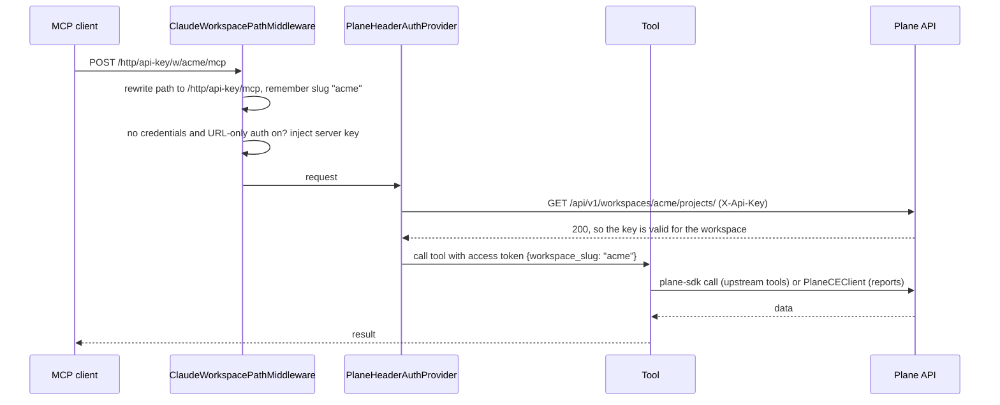

# Architecture

## Layout

```
cloudshift-plane-mcp/
├── plane_mcp/                  # MCP server (upstream makeplane/plane-mcp-server + CloudShift changes)
│   ├── __main__.py             # CLI entry: stdio | http | sse; builds the Starlette app for HTTP
│   ├── server.py               # FastMCP factories: get_stdio_mcp / get_header_mcp / get_oauth_mcp
│   ├── client.py               # Resolves a PlaneClient + workspace for the current request
│   ├── claude_workspace.py     # /http/api-key/w/<slug>/ path rewrite and URL-only auth   [CloudShift]
│   ├── auth/
│   │   ├── plane_header_auth_provider.py   # API-key auth with CE-safe validation              [CloudShift changes]
│   │   └── plane_oauth_provider.py         # OAuth against Plane
│   ├── middleware.py           # Rate-limit retry + structured tool-call logging
│   ├── request_logging.py      # HTTP access logging
│   ├── storage.py, aws_secrets.py  # OAuth token store (memory / Redis / ElastiCache)
│   └── tools/                  # 177 upstream tools, one module per Plane domain
├── cloudshift/                 # Report and diagnostic tools                                [CloudShift]
│   ├── registration.py         # Registers cloudshift_plane_* tools
│   ├── tools/                  # MCP tool wrappers (reports.py, diagnostics.py)
│   ├── services/
│   │   ├── plane_fetch.py      # PlaneCEClient: httpx reader using CE /issues/ paths, 429 backoff
│   │   ├── metrics_service.py  # Deterministic classification and metrics
│   │   └── reporting_service.py# Builds the report payloads
│   ├── utils/                  # Dates/timezones, state normalization, name resolvers
│   ├── config.py               # CLOUDSHIFT_* settings
│   └── errors.py               # Error codes and the {success, data, error} envelope
├── tests/                      # pytest; tests/cloudshift uses synthetic fixtures (no network)
├── scripts/capability_probe.py # Read-only probe of which Plane endpoints your instance serves
├── deploy/                     # docker-compose, systemd unit, Caddy example, deploy.sh
└── docs/
```

## Transports

| Mode | Command | Auth | MCP instances |
|---|---|---|---|
| stdio | `plane-mcp-server stdio` | `PLANE_API_KEY` from the environment | `get_stdio_mcp()` |
| HTTP, API key only | `plane-mcp-server http` + `PLANE_MCP_DISABLE_OAUTH=true` | Per-request key | `get_header_mcp()` at `/http/api-key` |
| HTTP, API key + OAuth | `plane-mcp-server http` | Per-request key, or OAuth | header app + `get_oauth_mcp()` at `/http` and `/sse` |

All instances register the same 184 tools via `plane_mcp.tools.register_tools`, which also calls `cloudshift.registration.register_cloudshift_tools`.

## HTTP request flow (API key)



Workspace resolution order: `x-workspace-slug` header, then the `/w/<slug>/` path, then the `?workspace_slug=` query parameter, then `PLANE_WORKSPACE_SLUG`.

## Two ways of talking to Plane

| | Upstream tools (`plane_mcp/tools`) | Report tools (`cloudshift/`) |
|---|---|---|
| Client | `plane-sdk` (`PlaneClient`) | `PlaneCEClient` (httpx) |
| Credentials | The caller's key and workspace | The server's `PLANE_API_KEY` / `PLANE_WORKSPACE_SLUG` |
| Work item paths | `/work-items/` (newer Plane) | `/issues/` (all CE versions) |
| Writes | Yes | No, read-only |

The report layer exists because older CE builds 404 on the SDK's newer endpoints. It's isolated in `cloudshift/` so upstream changes to `plane_mcp/tools` can be merged with few conflicts.

## Design rules

- **Numbers come from code.** `metrics_service` computes every count and percentage; the model only explains them.
- **No guessing.** Ambiguous names return `*_AMBIGUOUS` with candidates. Unsupported endpoints return `CAPABILITY_UNSUPPORTED`; they are never faked.
- **No secrets in errors or logs.** The error envelope carries a code, a message, and safe details only.

## Staying close to upstream

To pull upstream fixes:

```bash
git remote add upstream https://github.com/makeplane/plane-mcp-server.git
git fetch upstream
git merge upstream/main     # conflicts are usually limited to __main__.py, auth/, and tools/__init__.py
```

New tools from upstream register automatically. Run `uv run pytest` and regenerate [tools.md](tools.md) after merging.
